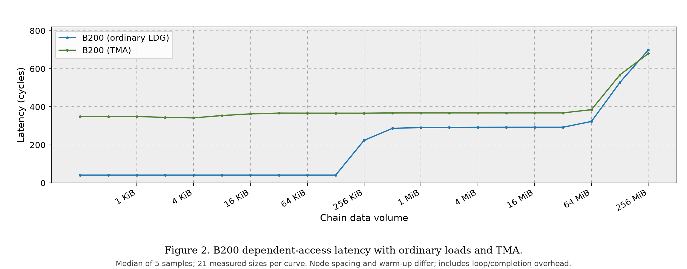
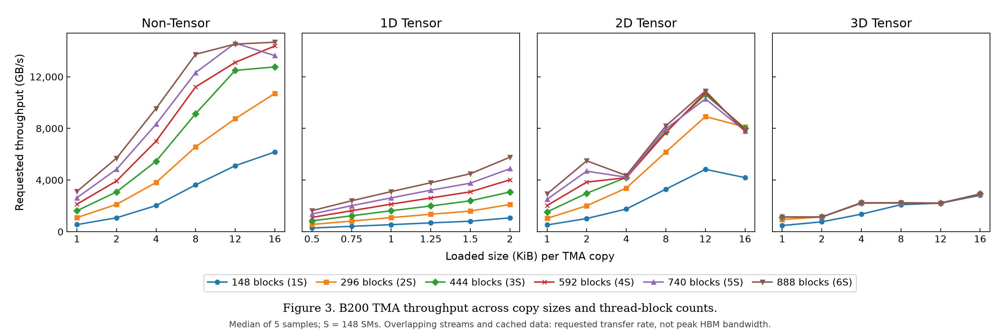
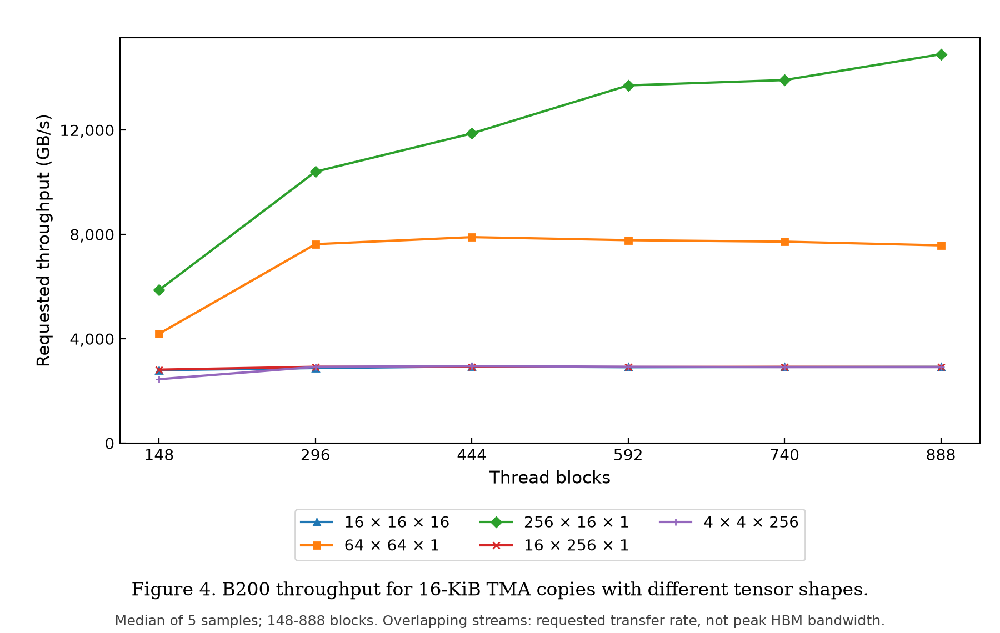

# B200 TMA baseline: 2026-10-11

**216 configurations, 1,080 individual samples; all correctness checks passed.**
The run took 13m 40s. These are experimental baseline measurements, not qualified
peak-bandwidth or instruction-latency claims.

| Configuration | Value |
|---|---|
| GPU | NVIDIA B200, 148 SMs, 126.5 MiB L2 |
| Driver / CUDA Driver API | 570.211.01 / 12.8 (`12080`) |
| Host Python | 3.12.3 |
| Offline tools | PTXAS 12.8.93; nvdisasm 13.4.92 |
| Latency | 21 working sets each for ordinary LDG and TMA |
| Throughput | 29 variants at S through 6S blocks (148–888) |
| Samples | Five per configuration; sequential GPU workers |

The date uses America/Los_Angeles; recorded telemetry timestamps are October 12 UTC.

## Files and reproduction

- `summary.json` / `summary.csv`: all 216 configurations and aggregate statistics.
- `samples.csv.gz`: all 1,080 samples, including per-CTA cycles, event timings,
  correctness status, output hashes and surrounding telemetry.
- `provenance.json`: source, CUBIN, qualification and original-result hashes;
  runtime, device geometry and campaign settings. Hostname, GPU UUID and PCI ID
  are deliberately omitted.
- `figures/`: Figures 2–4 in PNG/PDF/SVG, plotted values and plotting provenance.

From the repository root, verify the export with only the Python standard library:

```sh
python3 -m microbenchmark.blackwell.plots.publication \
  --results microbenchmark/blackwell/results/b200-20261011
```

This checks file hashes and recomputes every aggregate statistic from the samples.
To regenerate the figures without a GPU or private archive:

```sh
python3.12 -m venv /tmp/f2asm-plot-env
/tmp/f2asm-plot-env/bin/python -m pip install matplotlib==3.11.2
MPLCONFIGDIR=/tmp/f2asm-mplconfig /tmp/f2asm-plot-env/bin/python \
  -m microbenchmark.blackwell.plots.paper_figures --published \
  --results microbenchmark/blackwell/results/b200-20261011 \
  --output /tmp/b200-tma-figures
```

Plots use medians: event-based requested throughput across five samples, and
cycle measurements across samples/CTAs. Figure 2 has one CTA per configuration.
Styles are inspired by Figures 2–4 of [the Hopper microbenchmarking paper](https://arxiv.org/abs/2501.12084);
these are our B200 measurements, not digitized Hopper results.

## Scope and limitations

- Throughput is **requested transfer GB/s, not distinct HBM bandwidth**: CTA
  streams overlap and data can be cached. Each CTA completes one copy before
  issuing the next.
- LDG/TMA node spacing and warm-up differ. Subtracting the latency curves does
  not isolate TMA hardware overhead. Loop/address/completion work remains timed;
  CUDA events additionally include setup and final-tile export.
- Each sample checks the checksum/final index and, for TMA, the full final tile,
  not every byte of every transfer. Passing checks do not establish timing accuracy.
- Gather4, CTA-pair and the new swizzle modes are not included.
- This is a de-identified **derived dataset**, not the complete raw-evidence
  archive or a prepared-CUBIN release. Export first verified every retained raw
  output and worker source snapshot. Those buffers/snapshots and the unreleased
  assembler remain local; the public verifier cannot recheck omitted artifacts.
  Measured source hashes describe the original run, before publication-only
  verification/export changes. No GPU rerun is claimed for those changes.

Full-archive SHA-256:
`894a027c9ff20e73205f98ed1ef0f5569d7ccdbf8ef404e988c875fe40d16ef9`.
See the [runbook](../../RUNBOOK.md) for executing a new campaign with separately
prepared CUBINs; this incremental public release does not yet include the full assembler.




